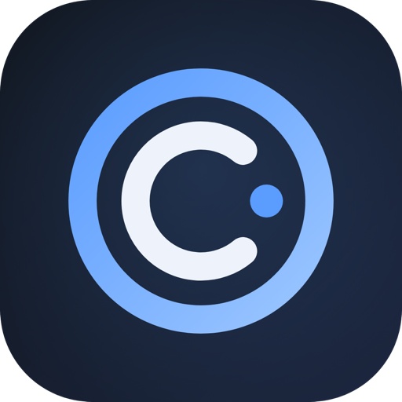
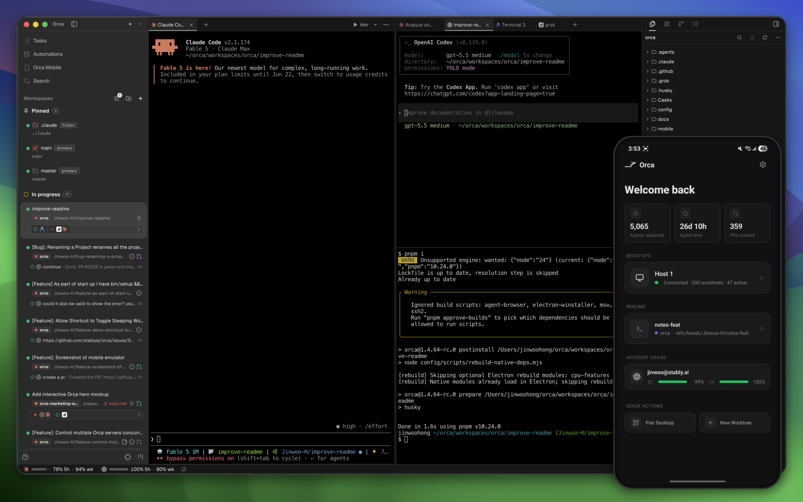
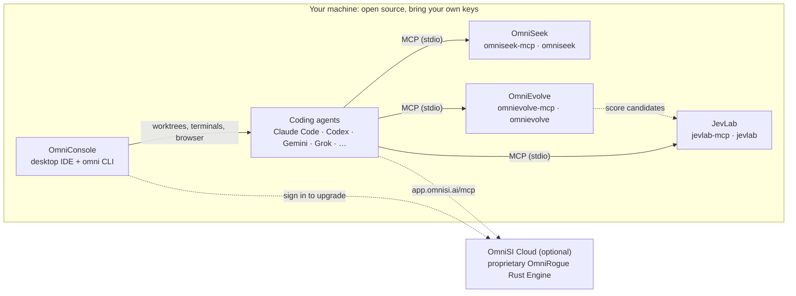
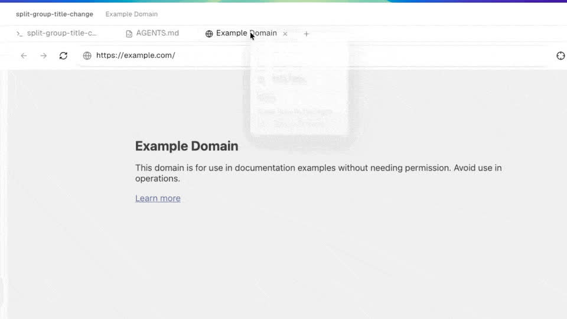
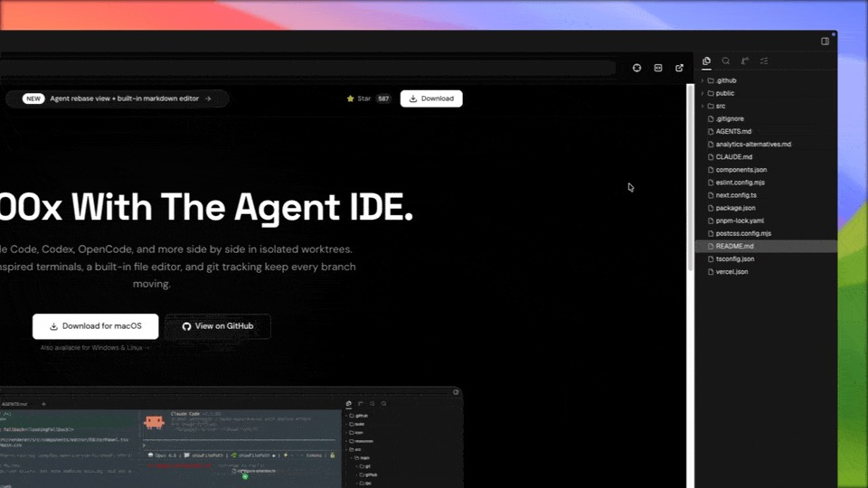

<h1 align="center">
  <a href="https://github.com/omnirogue/omniconsole"></a> OmniConsole
</h1>

<h3 align="center">The Open-Source Multi-Agent Super-Intelligence IDE</h3>

<p align="center">
  <a href="https://github.com/omnirogue/omniconsole"></a>
  <a href="https://github.com/omnirogue/omniconsole/releases"></a>
  <a href="LICENSE"></a>
  
</p>

<p align="center">
  Run Claude Code, Codex, Gemini, Grok and 30+ other coding agents side by side, each in its own Git worktree,<br/>
  with embedded terminals and a real browser, then ground, judge and evolve their output with the local<br/>
  <strong>OmniSI Open-Source Suite</strong>. Bring your own keys; everything below runs on your machine.
</p>

<h4 align="center">
  <a href="#quickstart">Quickstart</a>
  &nbsp;·&nbsp;
  <a href="#architecture-and-ecosystem">Ecosystem</a>
  &nbsp;·&nbsp;
  <a href="#the-omni-cli">CLI</a>
  &nbsp;·&nbsp;
  <a href="#open-source-and-omnisi-cloud">Open Source vs. Cloud</a>
  &nbsp;·&nbsp;
  <a href=".github/CONTRIBUTING.md">Contributing</a>
</h4>

<p align="center">
  
</p>

## Why OmniConsole

Coding agents are fast; supervising five of them at once is the hard part. OmniConsole is a
desktop IDE built around that job:

- **Parallel by default.** Fan one task across several agents and models, each isolated in its
  own Git worktree or folder workspace, then compare the diffs and keep the best one.
- **Every tool in one window.** Terminals, a Chromium browser, file explorer, diff review and
  GitHub, GitLab and Linear integration, all scoped to the workspace an agent is working in.
- **Local, SSH or WSL.** Agents run wherever the code lives, with sessions that reattach after
  a disconnect or an app restart.
- **Verifiable output.** The OmniSI Open-Source Suite adds citation grounding (OmniSeek),
  evolutionary optimization (OmniEvolve) and calibrated LLM judging (JevLab) over MCP, so agent
  work is checked rather than taken on trust.
- **Scriptable.** The `omni` CLI drives worktrees, terminals, sessions and the embedded browser,
  for you or for the agents themselves.

## Architecture and ecosystem

OmniConsole is the workbench of the **OmniSI Open-Source Suite**: four open-source projects under
[github.com/omnirogue](https://github.com/omnirogue) that run locally and talk to each other
through MCP and plain CLIs.



| Project | Repository | Runs locally as | What it does |
| --- | --- | --- | --- |
| **OmniConsole** | [omnirogue/omniconsole](https://github.com/omnirogue/omniconsole) | Desktop app, `omni` | The multi-agent IDE: worktree orchestration, terminals, browser, review and the `omni` CLI. |
| **OmniSeek** | [omnirogue/omniseek](https://github.com/omnirogue/omniseek) | `omniseek-mcp`, `omniseek` | Multi-lens codebase discovery and a deterministic verifier that checks every cited file and line. |
| **OmniEvolve** | [omnirogue/omnievolve](https://github.com/omnirogue/omnievolve) | `omnievolve-mcp`, `omnievolve` | Evolutionary code and prompt optimization with a local SQLite lineage ledger. |
| **JevLab** | [omnirogue/jevlab](https://github.com/omnirogue/jevlab) | `jevlab-mcp`, `jevlab` | LLM-as-judge calibration, swap- and length-bias diagnostics and agreement benchmarks. |

Install the three tools from their repositories, then give your agents the local MCP servers. The
same entries work in `.mcp.json` (Claude Code), `.cursor/mcp.json` and Gemini CLI settings:

```json
{
  "mcpServers": {
    "omniseek": { "command": "omniseek-mcp", "args": [] },
    "omnievolve": { "command": "omnievolve-mcp", "args": [] },
    "jevlab": { "command": "jevlab-mcp", "args": [] }
  }
}
```

The suite's catalog lives in code at
[`src/shared/omnisi-oss-ecosystem.ts`](src/shared/omnisi-oss-ecosystem.ts):
`getDefaultOmniSiOssMcpServers()` returns exactly these entries, and
`getOmniSiCloudUpgradeCapabilities()` lists what OmniSI Cloud adds on top. See
[The OmniSI Open-Source Suite](docs/oss/OMNISI-OSS-ECOSYSTEM.md) for the full guide.

## Quickstart

**Download:** prebuilt apps for macOS (Apple Silicon and Intel), Windows and Linux are published
on [GitHub Releases](https://github.com/omnirogue/omniconsole/releases).

**Build from source** with Git, **Node.js 24** and **pnpm 12** (the exact pnpm version is pinned in
`package.json`):

```bash
git clone https://github.com/omnirogue/omniconsole.git
cd omniconsole
pnpm install && pnpm dev
```

Native modules need your platform's compiler toolchain (Xcode Command Line Tools, build-essential,
or Visual Studio Build Tools). To package installers:

```bash
pnpm build          # typecheck and bundle main, preload and renderer
pnpm build:mac      # or build:win / build:linux
```

On first launch, add a repository or folder, pick the agents you have installed, and start a
session. No account is required. Provider sign-in stays with each agent's own CLI; OmniConsole
never switches a session to an account you did not choose.

## Git worktree orchestration

Each agent session gets its own workspace: a Git worktree on its own branch, or a plain folder
when the project is not a Git repository. Agents never trample each other's files, and you
review each result as an ordinary diff.

- **Fan out** one prompt to several agents or models and compare their worktrees side by side.
- **Start from work items:** open a worktree straight from a GitHub or GitLab pull request or
  issue, or a Linear task.
- **Review in place:** annotate any diff line and send the comments back to the agent that wrote it.
- **Setup scripts** in `omni.yaml` prepare each new worktree: install dependencies, copy env
  templates, start services.
- **Remote hosts:** the same workflow over SSH or WSL, with file editing, Git diffing, port
  forwarding and automatic reattachment.

```bash
cd ~/code/my-app
omni repo add --path .
omni worktree create --name fix-login --agent claude --prompt "Fix the login timeout"
omni worktree list --json
```

## Embedded terminal and browser

- **Terminals:** WebGL-accelerated splits with persistent, daemon-backed scrollback that survives
  app restarts, plus shell integration so OmniConsole knows when an agent is idle or waiting.
- **Browser and Design Mode:** a real Chromium view per workspace. Click any element to send its
  HTML, CSS and a cropped screenshot into an agent's prompt, or let agents drive it through the
  CLI (`omni goto`, `omni snapshot`, `omni click`, `omni fill`).
- **Mobile companion:** watch and steer sessions from iOS or Android over your own network.

<table>
<tr>
<td width="50%"><picture><source srcset="docs/assets/feature-wall/parallel-worktrees.gif" type="image/gif"></picture></td>
<td width="50%"><picture><source srcset="docs/assets/feature-wall/terminal-splits.gif" type="image/gif"></picture></td>
</tr>
<tr>
<td width="50%"><picture><source srcset="docs/assets/feature-wall/design-mode.gif" type="image/gif"></picture></td>
<td width="50%"><picture><source srcset="docs/assets/feature-wall/ssh-worktrees.gif" type="image/gif"></picture></td>
</tr>
</table>

## The `omni` CLI

OmniConsole ships an `omni` command; install it from the app to put it on your `PATH`. Commands
accept `--json` for scripting, and `omni <command> --help` prints the full usage. Agents running
inside OmniConsole use it too.

| Area | Commands | Example |
| --- | --- | --- |
| App | `status`, `open` | `omni status --json` |
| Repositories | `repo add`, `repo list`, `repo show` | `omni repo add --path . --kind git` |
| Worktrees | `worktree create`, `worktree list`, `worktree show`, `worktree rm` | `omni worktree create --name spike --agent codex --prompt "Try a cache"` |
| Terminals | `terminal create`, `terminal send`, `terminal read`, `terminal wait` | `omni terminal create --worktree active --command "pnpm dev"` |
| Browser | `goto`, `snapshot`, `click`, `fill`, `tab list` | `omni goto --url http://localhost:5173` |
| Sessions | `session list`, `session launch`, `session show`, `session handoff` | `omni session list --state stalled --json` |
| Workflows | `workflow run`, `workflow status` | `omni workflow run --template discover --prompt "Where is auth enforced?"` |
| Skills | `skills list`, `skills install`, `skills share` | `omni skills install --all` |
| Server | `serve` | `omni serve --port 6768` (headless Linux host) |

The bundled agent skills in [`skills/`](skills/) and [`skill-guides/`](skill-guides/) teach agents
to use the CLI. For a headless server, see
[docs/reference/headless-linux-server.md](docs/reference/headless-linux-server.md).

## Open source and OmniSI Cloud

Everything in the left column is free and open source: this repository and its sibling projects.
OmniSI Cloud is an optional hosted upgrade for teams that need more scale.

| | **OmniConsole Open Source**<br/>Local BYO key + local MCP suite | **OmniSI Cloud**<br/>Proprietary Rust Engine: 100x throughput, Pareto/novelty Evolve, calibrated multi-family JEV oracle, team RBAC and fleet |
| --- | --- | --- |
| **Price and license** | Free and open source (OmniConsole: MIT) | Hosted service |
| **Models and keys** | Your own provider CLIs, subscriptions and API keys | Your keys, or OmniRogue unified credits across model families |
| **Agents and workspaces** | Unlimited parallel agents, worktrees and folders on your machines, SSH and WSL hosts | Plus a managed execution fleet for long and parallel runs |
| **Discovery and grounding** | OmniSeek: multi-lens discovery and deterministic citation checks | The same tools, run at batch scale on the hosted engine |
| **Evolution** | OmniEvolve: single-objective search with a local SQLite lineage ledger | Pareto multi-objective fronts and novelty search across hosted populations |
| **Judging** | JevLab: calibrate and debias the judges you run | A calibrated judge ensemble spanning model families, as a service |
| **Throughput** | Bounded by your hardware and provider rate limits | The OmniRogue Rust Engine, built for up to 100x evaluation throughput |
| **Collaboration** | One person, their machines and accounts | Shared workspaces, role-based access control, audit and fleet management |
| **Connect with** | Nothing; it works offline from OmniSI | Sign in from OmniConsole, or add `https://app.omnisi.ai/mcp` to any MCP client |

The open-source projects never require the cloud, and the cloud never requires you to give up local
execution. The OmniRogue Rust Engine is not part of this repository.

## Supported agents

If it runs in a terminal, it runs in OmniConsole. Detected out of the box:

<p>
  <a href="https://docs.anthropic.com/claude/docs/claude-code"><kbd> Claude Code</kbd></a> &nbsp;
  <a href="https://github.com/openai/codex"><kbd>Codex</kbd></a> &nbsp;
  <a href="https://antigravity.google/docs/cli-overview"><kbd>Gemini / Antigravity</kbd></a> &nbsp;
  <a href="https://x.ai/cli"><kbd>Grok</kbd></a> &nbsp;
  <a href="https://www.kimi.com/code/docs/en/kimi-code-cli/getting-started.html"><kbd>Kimi</kbd></a> &nbsp;
  <a href="https://opencode.ai/docs/cli/"><kbd>OpenCode</kbd></a> &nbsp;
  <a href="https://cursor.com/cli"><kbd>Cursor</kbd></a> &nbsp;
  <a href="https://docs.github.com/en/copilot/how-tos/set-up/install-copilot-cli"><kbd>GitHub Copilot</kbd></a> &nbsp;
  <a href="https://ampcode.com/manual#install"><kbd>Amp</kbd></a> &nbsp;
  <a href="https://github.com/QwenLM/qwen-code"><kbd>Qwen Code</kbd></a> &nbsp;
  <a href="https://block.github.io/goose/docs/quickstart/"><kbd>Goose</kbd></a> &nbsp;
  <a href="https://docs.cline.bot/cline-cli/overview"><kbd>Cline</kbd></a> &nbsp;
  <a href="https://docs.continue.dev/guides/cli"><kbd>Continue</kbd></a> &nbsp;
  <a href="https://hermes-agent.nousresearch.com/docs/"><kbd>Hermes Agent</kbd></a> &nbsp;
  <a href="https://pi.dev"><kbd>Pi</kbd></a> &nbsp;
  <kbd>+ 20 more</kbd>
</p>

An optional OmniRogue account adds one-click sign-in, a unified model gateway and the hosted MCP
tools; see the [connector guide](docs/oss/OMNIROGUE-CONNECTOR-GUIDE.md) and the
[unified MCP reference](docs/oss/UNIFIED-MCP-REFERENCE.md).

## Community

- **Questions and ideas:** [GitHub Discussions](https://github.com/omnirogue/omniconsole/discussions)
- **Bugs and feature requests:** [GitHub Issues](https://github.com/omnirogue/omniconsole/issues)
- **Contributing:** read the [contributing guide](.github/CONTRIBUTING.md) and the
  [Code of Conduct](.github/CODE_OF_CONDUCT.md). Good first issues are labeled.
- **Security:** report vulnerabilities privately as described in the
  [security policy](.github/SECURITY.md), never in a public issue.

If OmniConsole is useful to you, a [star on GitHub](https://github.com/omnirogue/omniconsole)
helps others find it.

## License and attribution

OmniConsole is free and open source under the [MIT License](LICENSE), copyright OmniRogue Inc.
It is built on [Orca](https://github.com/stablyai/orca) by Stably AI, also MIT-licensed; the
original copyright notice is preserved in [LICENSE](LICENSE).
