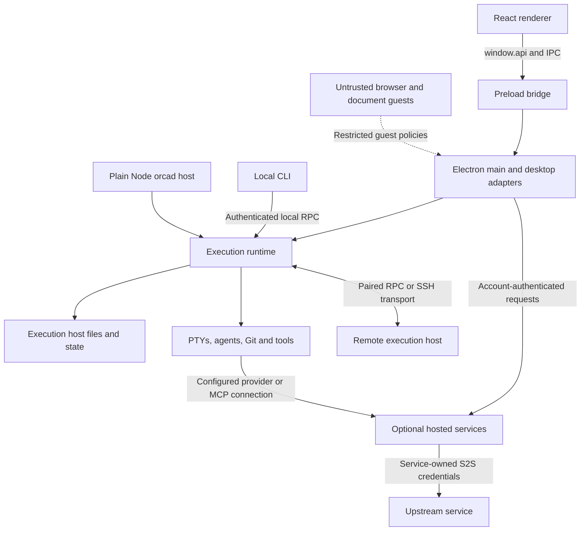

# Architecture and Security

OmniConsole combines an Electron desktop with an execution runtime that can also
run on plain Node.js. The desktop presents work; the execution host owns the
processes, files, credentials, and durable state needed to perform it. Optional
remote hosts and hosted services introduce additional trust boundaries.

This guide describes the source snapshot reviewed on **2026-10-16**. Source links
refer to this checkout, not proof of a deployed service's configuration. The S2S
section distinguishes implemented relay authentication from requirements for a
separate hosted HTTP service. This document is an architecture guide, not an
independent security audit or a guarantee that every handler has identical checks.

## Contents

- [System map and trust model](#system-map-and-trust-model)
- [Electron process boundaries](#electron-process-boundaries)
- [Electron-free execution runtime](#electron-free-execution-runtime)
- [Runtime and remote authentication](#runtime-and-remote-authentication)
- [S2S HMAC authentication](#s2s-hmac-authentication)
- [Local-first privacy and data flows](#local-first-privacy-and-data-flows)
- [Contributor verification checklist](#contributor-verification-checklist)
- [Reporting vulnerabilities](#reporting-vulnerabilities)

## System map and trust model



The Electron and Node hosts are alternative compositions of runtime services.
The diagram does not imply that a desktop always launches a separate `orcad`,
that all outbound traffic passes through one gateway, or that every hosted
service uses the same authentication protocol.

| Component | Responsibilities | Trust and authority |
| --- | --- | --- |
| `src/renderer/src/` | React UI, presentation, interaction, client state | Treat page-derived data and IPC arguments as untrusted. UI visibility is not authorization. |
| `src/preload/` | Bridge between renderer JavaScript and Electron IPC | Privileged exposure surface; every exported operation adds reachable authority. |
| `src/main/` | Desktop lifecycle, IPC handlers, credential integration, persistence | Runs with the desktop user's OS privileges. Owns native desktop capabilities. |
| `src/main/runtime/` | Sessions, workflows, RPC methods, execution coordination | Authoritative services; validate requests and enforce resource ownership here. |
| `src/main/orcad/` | Plain Node runtime entry and host adapters | Same execution authority without a desktop window or Electron dependency in the core graph. |
| `src/shared/` | Types, schemas, protocol and host-port contracts | Shared types document contracts; types alone do not validate runtime input. |
| Agents, MCP servers, repository scripts | User-selected tools and subprocesses | Executable code with the launching account's access, unless separately isolated. |
| Hosted services | Optional account, inference, media, collaboration and billing functions | Separate operators, authentication, authorization and retention policies. |

The principal threats are untrusted web content reaching native capabilities,
forged or replayed requests, credential disclosure, stale clients acting on the
wrong host or resource, and unintended transfer of private workspace data.
Renderer isolation does not protect against a compromised OS account, an
authorized malicious tool, or an agent deliberately given access to sensitive
files. A Git worktree separates changes; it is not a security sandbox.

## Electron process boundaries

### Main process: native capability owner

The [desktop entry](../../src/main/index.ts) composes services and installs
Electron adapters. Filesystem access, process launch, credential storage, and
desktop integration belong behind this boundary rather than in UI components.

The [main window factory](../../src/main/window/createMainWindow.ts) installs
the app preload, explicitly enables `sandbox: true`, and enables `webviewTag`
for embedded guests. It relies on Electron's defaults for context isolation and
disabled Node integration; it does not explicitly set those two preferences in
this constructor. Those defaults and the importance of validating IPC senders
are described in Electron's [security guidance](https://www.electronjs.org/docs/latest/tutorial/security).
New windows must be checked independently instead of inheriting assumptions
about this constructor.

### Preload: an API boundary, not an authorization decision

The [preload entry](../../src/preload/index.ts) exposes `window.api` and the
toolkit's `window.electron` through `contextBridge` when context isolation is
active. It also contains a direct-global fallback for a non-isolated context;
that fallback is not a reason to disable isolation. The exposed toolkit API and
the generic runtime bridge mean this is a broad surface, not proof that every
renderer action is a narrowly scoped capability.

For application features, use explicit bridge methods and serializable data.
Keep credentials and native objects out of returned values. Event subscriptions
should forward the intended payload, avoid exposing the Electron event object,
and return a cleanup function. A TypeScript signature on either side does not
make a compromised renderer's arguments trustworthy.

The runtime request path is:

1. A renderer invokes `window.api.runtime.call({ method, params })`.
2. Preload sends `runtime:call` through `ipcRenderer.invoke`.
3. The [main IPC handler](../../src/main/ipc/runtime.ts) checks that the sender
   frame is its current main frame and supplies desktop connection context.
4. The [RPC dispatcher](../../src/main/runtime/rpc/dispatcher.ts) looks up the
   registered method and parses parameters through the method's schema before
   invoking runtime behavior.
5. The result returns as an RPC response; subscriptions have a corresponding
   unsubscribe and sender-lifecycle path.

The `desktop-ipc` token in that internal dispatch is a marker, not a network
credential. Network requests must pass their own authentication boundary.
Sender and schema checks vary by handler: the runtime call check is not evidence
that every legacy IPC channel validates the same conditions. Review each new
handler for expected window/frame identity, resource scope, argument limits,
and the authorization required for its operation.

### Renderer and embedded guests: separate levels of trust

The React application is the trusted UI surface, but input it displays can
originate in repositories, terminal output, remote hosts, generated documents,
or websites. Escape text, constrain rendered links and HTML, and never turn
display content into executable commands without the appropriate user action
and service-side validation.

Browser guests and document/artifact previews must not receive the app bridge.
The [webview attachment policy](../../src/main/window/main-window-webview-security.ts):

- Checks the requested URL and partition against the recognized guest types.
- Removes caller-supplied preload settings and inherited arguments.
- Gives artifact previews no preload; other approved guest types receive only
  their purpose-specific preload.
- Forces context isolation, sandboxing, and web security on; disables Node
  integration, Node integration in subframes, and insecure mixed content.
- Retains the validated partition so browser-profile storage stays scoped.

Guest-specific navigation, popup and permission policies still matter. Do not
assume an embedded page is trustworthy because its URL points to localhost or
because an agent generated it. A partition separates browser state; it does not
grant authority to call application IPC.

## Electron-free execution runtime

### Shared services, different host adapters

[`OrcaRuntimeService`](../../src/main/runtime/omni-runtime.ts) and runtime RPC
are usable without importing Electron. The
[`orcad` entry](../../src/main/orcad/orcad-entry.ts) installs Node host adapters,
constructs the runtime, installs the headless PTY integration, and serves RPC.
Its [executable entry](../../src/main/orcad/main.ts) performs native-module
preflight before starting execution.

Host facilities are supplied through contracts such as
[`AppEnvironment`](../../src/shared/app-environment.ts),
[`SecretStore`](../../src/shared/secret-store.ts), and the
[runtime desktop surface](../../src/main/runtime/runtime-desktop-surface.ts).
Desktop implementations live under `src/main/host/`; runtime modules depend on
the contract rather than importing Electron to obtain paths or secrets.

Headless operation has real capability differences. There is no renderer window
or native desktop notification surface. Browser automation is installed only
when an available browser provider is established, such as an Electron serve
sidecar or operator-supplied Chromium. An optional Electron sidecar does not make
Electron a dependency of the Node core. Native PTY and other platform modules
still need compatible builds: Electron-free does not mean dependency-free.

### Enforced import boundary

The [runtime Electron ratchet](../../config/scripts/check-runtime-electron-ratchet.mjs)
bundles the import graphs rooted at the runtime service, RPC server and `orcad`
entry, then compares Electron importers with the
[checked-in baseline](../../config/runtime-electron-baseline.txt). The baseline
is empty in this snapshot. Keep it empty; move a new desktop dependency behind
a host port rather than adding an exception.

The [`orcad` build](../../config/scripts/build-orcad.mjs) also inspects its bundle
and smoke-loads it under plain Node. Import-graph checks establish portability,
not authentication correctness or end-to-end feature parity. Relevant commands
for a runtime change are `pnpm run check:runtime-electron-ratchet` and
`pnpm run build:orcad`, followed by focused behavior checks for the changed path.

### Execution ownership and lifecycle

The execution computer owns its processes, working directories, account state,
and process-liveness evidence. A desktop observing an SSH session must ask that
host before acting; a matching local PID or path cannot identify the remote
resource. Loss of contact means **unverifiable**, not **exited**. Preserve the
`live` / `unverifiable` / `exited` vocabulary in the
[SSH execution contract](../reference/ssh-execution-boundary.md).

Clients and remote hosts upgrade independently. Follow the
[wire compatibility contract](../reference/remote-wire-compatibility.md):
negotiate new capabilities, preserve older clients' behavior, and avoid treating
missing fields or unknown events as evidence that work has stopped. Filesystem
and execution rules apply to ordinary folder workspaces as well as Git worktrees.

## Runtime and remote authentication

Authentication answers who may enter a protocol. Authorization determines which
resource and operation that caller may use. Neither automatically supplies a
human approval required for a consequential action.

| Boundary | Mechanism visible in this checkout | Security implication |
| --- | --- | --- |
| Desktop renderer to main | Electron IPC, sender checks on sensitive paths, method schemas | No service HMAC secret belongs in the renderer. |
| Local CLI to runtime | Runtime token from local metadata, Unix socket or Windows named pipe | Possession of the token is authority; protect metadata and the OS account. |
| Paired remote/mobile client | Pairing offers, device credentials and remote transport handling | Treat pairing material as a secret and revoke devices through supported controls. |
| Host to relay control service | Encrypted challenge and HMAC acknowledgement | Binds a proof to a particular host, identity and connection context. |
| Desktop/agent to hosted tools | Account or provider credentials for the selected service | Distinct from inter-service shared secrets; permissions and billing remain service-specific. |

The [local request admission layer](../../src/main/runtime/runtime-rpc/runtime-rpc-request-admission.ts)
requires a nonempty request ID, method and authentication token, rejects a token
that does not match, and bounds long-poll admission. The
[metadata writer](../../src/main/runtime/runtime-metadata.ts) uses secure JSON
file writing. [Transport metadata](../../src/main/runtime/runtime-rpc/runtime-rpc-socket-metadata.ts)
selects Unix sockets or per-runtime Windows named pipes. Endpoint naming is not
a substitute for authentication or Windows filesystem/access-control policy.

[`orcad` binds to `127.0.0.1` by default](../../src/main/orcad/orcad-bind-address.ts).
Explicit `--bind` changes can expose it beyond the host; `localhost` is accepted
as loopback and other hostnames are refused in favor of literal IPs. An SSH local
port-forward is the documented way to reach a loopback service remotely. Creating
a [mobile pairing offer](../../src/main/runtime/runtime-rpc/runtime-rpc-mobile-pairing.ts)
can opt the desktop into network exposure. Loopback defaults therefore do not
mean the application can never listen on the LAN.

Keep pairing URLs, device tokens and runtime metadata out of public logs and
screenshots. Use encrypted transports for off-host traffic. Authentication does
not itself encrypt a connection, and a successfully paired client still needs
operation-specific ownership and authorization checks.

## S2S HMAC authentication

### Scope: hosted service contracts are separate

S2S means **server-to-server**. A backend may authenticate another backend with
a shared-key message authentication code while the desktop uses an account
credential. Shared S2S keys belong only on the participating trusted services:
never bundle them in renderer JavaScript, preload, a distributable desktop app,
repository configuration, or an agent prompt. A shipped desktop cannot keep a
fleet-wide service secret confidential from its users.

**This checkout does not define a generic HTTP S2S HMAC signer/verifier or a
public header/canonicalization contract for the hosted services.** Do not infer
header names, signing strings, timestamp units, accepted clock skew or replay
semantics from this guide. Obtain the receiving service's versioned contract
and test vectors before implementing an integration. An account bearer token,
an API key, runtime pairing and an HMAC proof are different protocols.

### Implemented example: relay host proof

The concrete HMAC implementation is
[`relay-host-proof.ts`](../../src/main/runtime/relay/relay-host-proof.ts), with
[focused tests](../../src/main/runtime/relay/relay-host-proof.test.ts). It proves
that a host can decrypt a relay challenge; it is not a reusable HTTP request
signing algorithm.

1. Decode the relay's ephemeral public key and challenge nonce with canonical
   base64 and fixed-length checks. Decode the ciphertext and open its NaCl box
   using the host secret key.
2. Verify the plaintext domain `omni-relay-host-challenge/v1`, framing and exact
   trailing 32-byte challenge-secret length.
3. Validate the length-prefixed transcript: protocol/version, relay origin,
   ephemeral key, nonce, challenge ID, user/profile/organization, host ID and
   public key, assignment epoch, previous generation and resume intent.
4. Check issuance and expiry consistency. The implementation limits the
   challenge window to 10 seconds and allows 30 seconds of clock skew; that
   tolerance affects acceptance around expiry. These are relay-specific values.
5. Return a base64 HMAC-SHA256 acknowledgement keyed by the challenge secret:

   ```text
   HMAC-SHA256(secret, UTF8("omni-relay-host-proof/v1\0ack\0") || transcript)
   ```

Here `\0` denotes a NUL byte and `||` denotes byte concatenation. Transcript
comparisons use length checks and `timingSafeEqual`. Invalid challenges return
no proof. Domain separation and context binding prevent a proof from being
interpreted as a different kind of message. The receiving relay must still
enforce its challenge lifecycle; this host-side helper alone does not establish
server-side single-use replay protection.

### Requirements for an HTTP S2S integration

The following are design and review requirements, **not claims that this desktop
repository implements a hosted verifier**:

| Concern | Required contract or control |
| --- | --- |
| Signing input | Specify protocol version, HTTP method, exact path/query normalization, timestamp format, nonce/request ID, body representation or digest, and any identity/tenant fields that affect authority. |
| Byte agreement | Sign the agreed bytes. JSON reserialization, whitespace, URL decoding or proxy rewriting must not silently change the verified request. Publish positive and negative test vectors. |
| Key identity and scope | Map a key identifier to a server-held secret and explicit principal, tenant and permitted operations. Do not authorize a tenant solely from a caller-supplied header. |
| Verification | Bound sizes, reject malformed encodings and unknown/revoked keys, recompute the MAC, check decoded lengths, and use a timing-safe comparison. Verify before side effects. |
| Freshness and replay | Enforce the contract's clock window and atomically consume a nonce/request ID with appropriate expiry across all service replicas. A timestamp alone does not prevent replay within its window. |
| Authorization | Check resource ownership, method permission and any required approval after authenticating the caller. A valid MAC does not authorize every operation. |
| Retries | Specify idempotency separately from replay defense. A timeout must not trigger an uncontrolled duplicate charge or job; preserve the operation's idempotency identity. |
| Transport | Use authenticated TLS. HMAC provides message integrity/authentication, not payload confidentiality. |
| Key lifecycle | Use generated high-entropy secrets, restricted secret storage, distinct environment/service keys, auditable rotation and revocation, and a bounded rollover period where supported. |
| Failures and logs | Fail closed without downgrade to unsigned requests. Record sanitized request IDs and failure classes; exclude secrets, authorization headers, reusable proofs and private request bodies. |

Node provides [`createHmac` and `timingSafeEqual`](https://nodejs.org/api/crypto.html)
for the cryptographic primitives. Their use does not make surrounding parsing,
comparison, authorization or replay-cache logic safe automatically. Test altered
method/path/body, expired/future timestamps, duplicate nonces under concurrency,
wrong tenant, revoked keys, malformed signatures and retry behavior against the
actual receiving implementation.

## Local-first privacy and data flows

### Local ownership is the default architecture, not an offline guarantee

Workspaces, runtime state, terminal/agent execution and desktop settings are
owned by their execution hosts. Using a local CLI login does not require linking
an OmniRogue account. Hosted features, remote execution and networked agents can
send data off that host; local-first does not mean every operation stays offline.

| Data or action | Typical destination | What to consider |
| --- | --- | --- |
| Workspace files and Git changes | Selected local folder/worktree, or the remote execution host | Git remotes, scripts, agents and backups can transmit copies independently. |
| Session state, terminal output, logs and browser profiles | Application/provider state on the owning computer | Can contain source code, prompts, personal paths and credentials printed by tools. |
| Provider inference or hosted media/Evolve | Selected provider, gateway or hosted tool | Submitted prompts, files and job inputs cross that service boundary. Check its retention and account policy. |
| MCP calls | Configured local process or remote MCP endpoint | Tool arguments and results follow that server's permissions and implementation. |
| Pairing and remote sessions | Selected host and, for relay mode, relay infrastructure | Review the specific transport and metadata exposure; do not generalize encryption claims to all routes. |
| Publishing/sharing artifacts | The selected hosted destination and recipients | Uploading changes who can access the content; inspect content and access scope. |
| Product telemetry | PostHog in eligible official builds | Governed by build identity, consent and environment controls described below. |
| Diagnostic bundles | Local collection, then an explicit supported upload flow | Review the bundle before sharing; redaction is not proof that no private content remains. |

Account and billing routes are described in the
[OmniRogue connector guide](OMNIROGUE-CONNECTOR-GUIDE.md); hosted tool boundaries
are described in the [MCP reference](UNIFIED-MCP-REFERENCE.md). A local coding
session can still call hosted tools. Disabling telemetry does not disable those
requested connections, provider requests, update checks, or repository traffic.

### State and credential storage

Desktop paths come from the
[Electron app environment](../../src/main/host/electron-app-environment.ts).
For `orcad`, [path resolution](../../src/main/orcad/orcad-app-paths.ts) uses
`ORCA_USER_DATA` when set, otherwise `$XDG_DATA_HOME/OmniConsole`, otherwise
`~/.omni`. Logs are under that headless data root. Remote hosts have their own
state; sharing a repository does not share an authenticated provider account.

The [Electron secret store](../../src/main/host/electron-secret-store.ts) wraps
`safeStorage`. Protection depends on the OS backend and availability. In
particular, Linux `basic_text` uses a built-in key and is reported as a protection
gap rather than meaningful keyring protection. The shipped Node adapter in
`orcad-entry.ts` reports encryption unavailable and throws if asked to encrypt
or decrypt. Callers decide how to handle unavailable sealing; do not assume
headless credentials or all configuration files are encrypted at rest.

`SecretStore` protects selected secrets, not entire workspaces, transcripts or
backups. Restrict access to application state and provider configuration, use
appropriate OS account and disk protection, and inspect the active host's
protection status. Do not copy a whole profile to share one project. Disconnecting
an account does not by itself prove deletion from logs, backups, remote hosts or
the provider; those stores have separate lifecycles.

### Product telemetry: current behavior

The [telemetry client](../../src/main/telemetry/client.ts) is enabled at compile
time in this snapshot, but transmits product events only when the build contains
both an official stable/RC identity and a write key. Contributor builds without
that injected identity/key do not transmit through this client.

The [consent resolver](../../src/main/telemetry/consent.ts) applies these controls
in order: `DO_NOT_TRACK`, `ORCA_TELEMETRY_DISABLED`, CI detection, then the stored
preference. The two disable variables accept `1` or `true` (case-insensitive,
with whitespace trimmed); other nonempty values are not recognized as enabled
kill switches. Environment overrides do not rewrite the stored preference.

The [cohort migration](../../src/main/persistence/loading-store/loaded-cohort-migrations.ts)
defaults new profiles to `optedIn: true`; existing profiles without a choice
enter a pending-banner state. Missing preferences also resolve to pending, which
blocks ordinary event transmission. The banner acknowledgement path can persist
opt-in, and the explicit opt-out path attempts a final `telemetry_opted_out`
event before disabling the SDK. This is therefore **not an opt-in-only or
zero-telemetry design**.

Events pass through burst limits and schema validation. Common properties
include app version, platform/architecture, OS release, install ID, session ID
and release channel. The client disables GeoIP enrichment and person-profile
creation. Persistent identifiers still make events linkable; do not describe
them as inherently anonymous or infer that arbitrary logs are safe to upload.

### Diagnostics are a separate path

The [observability composition](../../src/main/observability/index.ts) writes
local diagnostic traces separately from product telemetry. `DO_NOT_TRACK=1`
and `ORCA_TELEMETRY_DISABLED=1` disable its diagnostic-bundle surface but retain
local file logging. `ORCA_DIAGNOSTICS_DISABLED=1` also disables the default local
trace sink; CI disables that sink and the bundle surface. Separately enabled
session-frame logging has its own lifecycle. These switches do not promise
removal of existing files or suppression of every subprocess/provider log.

Use the supported bundle flow, inspect the output, and remove private data
before sending it to another party. Include app version, platform, sanitized
error and request/run ID in a report; omit account tokens, pairing URLs,
S2S keys, raw authentication headers and private workspace content.

## Contributor verification checklist

For changes to these boundaries, select focused checks that exercise the actual
failure mode rather than relying only on typechecking:

- **IPC and guests:** test an unexpected sender/frame, malformed arguments,
  rejected URL/partition, preload injection, and subscription cleanup.
- **Runtime portability:** keep the Electron baseline empty; build and load
  `orcad` with compatible native modules and isolated state.
- **Authentication:** test missing/wrong credentials and revoked devices;
  verify authorization independently of authentication.
- **HMAC:** use the exact receiving protocol's vectors, context binding and
  replay/rotation tests. Relay proofs are not HTTP S2S fixtures.
- **Remote ownership:** test disconnects, stale generations, a different host
  with the same PID/path, and older clients without the new capability.
- **Privacy:** inspect payloads and diagnostic artifacts; exercise consent
  controls, unavailable keyrings, and headless secret-storage behavior.

Useful existing coverage includes
[runtime request authorization](../../src/main/runtime/runtime-rpc-request-authorization.test.ts),
[webview security](../../src/main/window/main-window-webview-security.test.ts),
[relay proof validation](../../src/main/runtime/relay/relay-host-proof.test.ts),
[secret-store behavior](../../src/main/host/electron-secret-store.test.ts), and
[telemetry consent](../../src/main/telemetry/consent.test.ts).
For documentation-only changes, verify source claims, relative links and
formatting; a full application test run is usually unnecessary. Follow the
[contribution guide](CONTRIBUTING.md) for repository checks and review.

## Reporting vulnerabilities

Follow the [security policy](../../.github/SECURITY.md) and report vulnerabilities
privately through its advisory or email channel. Include the affected build,
boundary, minimal reproduction and expected versus observed behavior. Keep
exploitable details and credentials out of public issues and pull requests.
