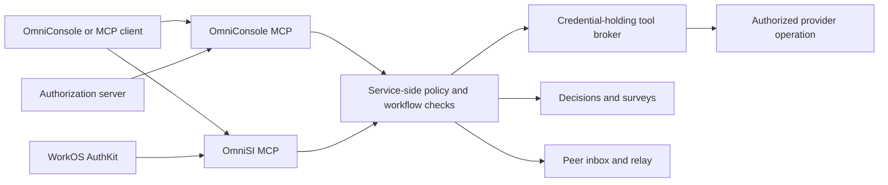

# RBAC, decisions, and team communications

Developer guide for the unified OmniConsole ↔ OmniSI MCP integration. The contract
joins authenticated identity, organization-shared services, human decisions, and
peer conversations while preserving each service's authorization boundary.

**Snapshot: 2026-10-16.** Desktop types and the advertised OmniConsole connector
schemas underpin this guide; the [unified MCP reference](UNIFIED-MCP-REFERENCE.md)
records the inspected OmniSI catalog. This checkout identifies OmniSI's WorkOS
OAuth endpoint but does not contain its broker server implementation. The WorkOS
organization mapping and enforcement rules below are integration requirements,
not evidence that every hosted deployment implements them. The connected server's
`tools/list`, authorization response, and receipts determine available behavior.

## 1. Unified contract and endpoint boundaries

| Surface | Endpoint | Relevant tools |
| --- | --- | --- |
| OmniConsole estate | `https://console.example.com/mcp` | `whoami`, `connect_services`, `capabilities`, `explain_access`, `invoke`, `artifact_*`, `peer_*` |
| OmniSI Cloud | `https://app.omnisi.ai/mcp` | `whoami`, `decision_*`, `study_*`, `page_*`, `session_*`, `relay_*`, `tools_list`, `tools_call`, subject to registration |

The desktop configuration names these `omni-console` and `omnisi`. Preserve an
existing alias, disabled entry, and provider-owned login. Adding a second entry
must not bypass an explicit disable. Configuration and account-linking details
are in the [connector guide](OMNIROGUE-CONNECTOR-GUIDE.md).

“Unified” means a consistent identity and workflow model. It does not mean equal
tool names, interchangeable tokens, or identical input schemas. In particular,
`connect_services` and `invoke` are advertised on the inspected OmniConsole
connector; the inspected OmniSI catalog instead exposes `tools_list` and
`tools_call`. Do not assume either endpoint implements the other's aliases.



The policy box denotes a shared requirement, not proof of a single deployed
database or identity bridge. An adapter must preserve authenticated actor,
organization, object owner, revision, and correlation IDs across a boundary.
It must refuse an unverified mapping instead of matching people by display name.

### Connection sequence

1. Authenticate to the exact resource through the client's supported OAuth flow.
   WorkOS AuthKit supplies MCP authorization; the resource server verifies the
   token's signature, issuer, expiry, and intended audience. Configure resource
   indicators consistently with that endpoint. See [WorkOS MCP authorization](https://workos.com/docs/authkit/mcp).
2. Let the MCP client negotiate `initialize` and send `notifications/initialized`.
   Read `tools/list`, following `nextCursor`; retain each tool's input schema.
3. Call `whoami` on each endpoint used. Confirm the intended principal and active
   organization where returned. A desktop login, ledger header, or SSH pairing
   is not proof of another MCP resource's authorization.
4. Discover the relevant tools and capabilities. Treat missing tools or unknown
   authorization fields as unavailable, not as permission to guess a route.
5. Invoke the exact advertised tool. Check HTTP/JSON-RPC failure, `isError`, and
   the application result; an HTTP 200 or queue receipt is insufficient.

For example, on the OmniConsole endpoint:

```json
{
  "jsonrpc": "2.0",
  "id": 1,
  "method": "tools/call",
  "params": {
    "name": "capabilities",
    "arguments": {"query": "customer records", "limit": 10}
  }
}
```

`X-Omni-Ledger-Session` and `X-Omni-Ledger-Attempt` correlate work to a producing
session. They do not authorize an employee, organization, or tool. Keep them
separate from credentials; use the existing [MCP login integration](../reference/omni-console-mcp-login.md).

## 2. WorkOS Org-Shared Tool Broker: `connect_services` + `invoke`

The broker runs a permitted operation using a centrally held provider credential.
The agent receives capability metadata and results, never that credential.
Organization sharing makes selected operations usable by authorized members;
it must not silently substitute the connection owner's personal authority for
the caller's policy.

WorkOS roles attach to organization memberships and group permissions. Map the
verified user and selected organization to the application's canonical principal
and capability policy on the server. Role slugs alone are not provider operation
IDs. See [WorkOS roles and permissions](https://workos.com/docs/authkit/roles-and-permissions).

WorkOS Connect is the OAuth/OIDC identity layer, not the application tool broker
or a provider credential vault. Its M2M identity represents an organization,
not an individual human approver. See [WorkOS Connect](https://workos.com/docs/authkit/connect).

### Discovery, consent, and execution

| Tool | Input contract | Meaning |
| --- | --- | --- |
| `connect_services` | `{}` | Requests OAuth permission to use services already allowed by the caller's role. Complete the returned consent flow, then rediscover capabilities. It neither grants company access nor executes a provider operation. |
| `capabilities` | Optional `query`, `company`, `domain`, `limit`, `task_id`, `job_id`, `grant_id` | Returns the caller's available capabilities and relevant restrictions. Use returned IDs rather than constructing them. |
| `explain_access` | Required `capability`; optional company/domain/work/grant context | Explains which policy layer decided access and who must approve. |
| `invoke` | Required `capability`; optional `method`, `path`, `query`, `body`, `dry_run`, `request_id`, `grant_id`, `job_id`, `task_id` | Checks policy and executes one provider operation. `dry_run: true` checks authorization without calling the provider. Mutations require `request_id`. |

Only request `connect_services` when service consent is needed. Repeated OAuth
consent cannot fix an RBAC denial. Do not invent a task to gain access; supply
work context only when the selected capability requires existing authorized work.

The following JSON objects are **tool arguments**, not complete JSON-RPC messages.
Angle-bracket values throughout this guide must be replaced with verified IDs or
schema-approved values. These examples are documentation, not instructions to
send messages or mutate an account.

```json
{
  "capability": "<read capability returned by capabilities>",
  "method": "GET",
  "path": "<provider path allowed by that capability>",
  "dry_run": true
}
```

After a permitted preflight, use the same validated operation without `dry_run`
for an authorized read. For a write, first describe the concrete effect and
obtain any required human approval. Then submit the approved operation:

```json
{
  "capability": "<approved write capability>",
  "method": "POST",
  "path": "<approved provider path>",
  "body": {"example_field": "<approved value>"},
  "request_id": "<persisted unique ID for this action>",
  "grant_id": "<broker-issued grant when required>"
}
```

Omit `grant_id` when the policy does not require it. A decision slug or a sentence
saying “approved” is not a broker grant. A successful dry run neither reserves
permission nor proves provider success; execution must check current policy again.

Persist the request ID before the first mutation. Reuse that ID and identical
arguments after an uncertain response; the gateway generates its idempotency
key. Do not change the payload under an existing key or generate another key
to evade a refusal. Reconcile unknown provider outcomes before another write.

On OmniSI, `tools_list({})` discovers owned and actively shared connections.
Where advertised, `tools_call` takes `provider`, `owner`, `operation`, `arguments`,
and optional `decision_id`. Use its returned sharing rules and schema. A bridge
between this form and `invoke` needs an explicit operation, owner, policy, and
approval mapping; renaming fields does not establish equivalent authorization.

### Broker enforcement requirements

- Derive actor and organization from verified authentication and membership;
  never trust caller-supplied organization, employee, or connection-owner IDs as
  authority. Scope connection lookup, discovery, caches, and results to that context.
- Resolve method, provider host, and allowed path from the capability registry.
  Reject arbitrary destination URLs and operations outside that registration.
- Check membership, sharing status, scope, policy, and any grant again at invocation.
  Revoked connections, removed members, expired grants, and hard denials must fail
  before provider execution, even if an older catalog showed the capability.
- Keep provider secrets server-side. Do not return bearer tokens, cookies, refresh
  tokens, or authorization URLs containing secrets in tool results or audit logs.
- Audit actor, organization, connection reference, capability, policy outcome,
  request ID, applicable approval, and provider receipt. Redact sensitive payloads.
  Record denied and uncertain calls as well as successful ones.

## 3. RBAC policy and access administration

The estate broker explains policy in the order **global → company → domain →
role → person → current task**. The server resolves the effective result;
clients must not infer that a later grant overrides every earlier denial.
The hard-denied floor is never grantable, including through a section or template.

| Layer or principal | What it controls | What it does not establish |
| --- | --- | --- |
| OAuth scopes | Delegated access to a resource/tool family | Organization membership or provider permission |
| WorkOS organization membership | Identity and role context for the selected organization | Access to another organization's connections |
| Console member / department access | Own work and the sections permitted by policy | Global visibility or tool-administration rights |
| Console admin | Broader console visibility and permitted administration | Every broker capability or super-admin standing-access rights |
| Broker super admin | Standing access changes through the supported admin API | Bypassing the hard-denied floor or fabricating human approval |
| Agent role / operation role | A separately granted capability set | Inheriting the human owner's full privileges by naming them |
| Decision answerer / reviewer | Answering an eligible question at its current revision | Executing provider writes, changing roles, or approving unrelated work |

Role names and assignments are deployment data. Do not hardcode an employee
allowlist or equate a WorkOS organization admin with an estate super admin.
UI section visibility is a presentation of policy; service endpoints enforce it.

### Reuse the Tool Shelf contract

`access_people({"principal":"me"})` reads the caller's effective access;
cross-person administrative reads require the corresponding privilege.
`access_sections` exposes derived sections and read/write references such as
`@section:<key>:read`. Sections include floor counts separately from grantable
capabilities. The desktop renders the server's counts and provenance.

Standing changes name an exact principal (`human:emp_<id>` or `agent:<role>`),
never `me`. Supported targets are a capability ID, connector pattern, or section
reference. A grant/deny carries a reason and `expected_digest`; removing an
override names its ID and expected digest. Refresh and review a changed digest
instead of overwriting a concurrent policy change. Grants may carry an expiry.

Bulk operations accept explicit rows, a named template, or a section column.
Use the existing dry-run diff before an authorized application; the contract is
all-or-nothing. A column with omitted principals can affect every human principal,
so name recipients explicitly for a bounded change. Read back effective access
and the audit receipt. Adding this guide grants no authority to change access.

## 4. One-to-one and one-to-many decisions and surveys

Choose a workflow by the required human outcome, not by recipient count:

| Need | OmniConsole | OmniSI |
| --- | --- | --- |
| One person chooses an option or approves a concrete action | `artifact_ask`, type `decision` or `approval` | `decision_ask`, using its advertised `kind` and answerer schema |
| Several people are eligible to decide one question | A decide-mode ask with explicit recipients and category | Advertised decision answerer policy |
| Each person gives independent feedback / survey answers | `artifact_ask`, type `review`, with `form` | Discover `decision_ask` fields/kinds; do not assume an equivalent survey mode exists |
| People review a document | `artifact_publish` with `review` | `page_publish` and its advertised ask/reviewer fields |
| Blind evaluation | `artifact_publish`, review type `study`, using its supported template | `study_create`, `study_get`, `study_submit`, `study_close` |

Naming several decision recipients does **not** establish unanimity, a vote,
quorum, or several independent approvals. Use collection mode when every person's
response matters. If execution requires multiple approvals, verify explicit
server support for that policy; do not substitute a survey tally.

### A one-to-one choice

Resolve the recipient first. `artifact_ask.people` accepts resolvable names or
emails; `artifact_publish.review.reviewers` should use canonical `emp_` IDs from
`list_employees`. A guessed name/email does not prove delivery.

```json
{
  "type": "decision",
  "title": "Select the integration review path",
  "question": "Which review path should this change use?",
  "details": "The change is documentation-only. Recommend the normal documentation review.",
  "category": "development",
  "people": ["<verified reviewer email>"],
  "options": ["Documentation review", "Additional architecture review"],
  "recommended": 1,
  "private": true,
  "idempotency_key": "<persisted ask ID>"
}
```

Lead with the decision, recommendation, effect, and uncertainty. Put supporting
evidence below it. Category influences who can answer; visibility controls who
can read. Set visibility intentionally and inspect returned delivery warnings.

Read `artifact_status` or `artifact_inbox` before answering. `artifact_decide`
requires the exact `revision` and either `pick` (an array of one-based option
numbers) or `decision` (`approve`, `changes`, `reject`). Relay only the signed-in
person's explicit answer, preserving their words. It cannot answer their own
published ask or submit a collect-mode response; those are answered on the page.

Decide-mode status is `pending`, `approved`, `changes_requested`, or `rejected`.
Revising after requested changes creates a new revision and resets the review.
An old answer cannot approve new content. Unknown states are not completion.

On OmniSI, discover the full `decision_ask` schema: its required fields include
`kind`, `title`, `question`, `why`, and `unknowns`; approval/choice asks require a
recommendation. `decision_answer` uses `expected_revision`. `decision_ack`
acknowledges delivery, while `decision_report` reports the authorized action with
its `grant_id`, `action_digest`, outcome, and evidence. Neither substitutes for
the person's answer or the broker's current authorization checks.

### A one-to-many survey

```json
{
  "type": "review",
  "question": "What should improve in the integration guide?",
  "category": "development",
  "people": ["<verified first reviewer email>", "<verified second reviewer email>"],
  "private": true,
  "form": [
    {"id": "clear", "label": "Is the authorization boundary clear?", "type": "yes_no"},
    {"id": "confidence", "label": "Confidence implementing it", "type": "rating", "scale": 5},
    {"id": "gap", "label": "What is missing?", "type": "long", "required": false}
  ],
  "idempotency_key": "<persisted survey ID>"
}
```

Forms support `yes_no`, `one`, `many`, `short`, `long`, and `rating`. Option inputs
use one-based numbers; ratings run from 1 to the declared scale. Required fields
must be answered where applicable. Add `due` as an ISO 8601 timestamp with timezone
within the advertised limit (currently 90 days on `artifact_ask`). `everyone`
is review-only and broadens who can answer; use it only for the intended audience.

Each response belongs to its authenticated respondent and revision. Collection
progress tracks submitted, outstanding, and set-aside responses; readiness may
mean all named people answered or the due time passed. It is not approval.
`responses_in` / artifact notices signal when to read status; avoid busy polling.
Summarize themes and disagreement, retain missing responses, and close only under
the owner's authority. Closure and completion of follow-up work are distinct.

For blind studies, preserve server redaction, shuffled items, and sealed labels.
OmniSI submission/closure uses `render_fingerprint`; do not reuse a fingerprint
from changed content. Do not reveal others' answers in a comment while a study
is open. A study result informs a decision; it does not authorize execution.

## 5. Instant peer communications

Peer tools connect a person's app conversation or an exact enrolled agent endpoint.
“Instant” describes the communication path, not a guarantee that a busy, offline,
or interrupted model consumes the message immediately. Discover the recipient
with `peer_directory`; use an exact `emp_`, `pc_`, or `ses_` ID when ambiguous.

| Step | Tool | Receipt boundary |
| --- | --- | --- |
| Send | `peer_send` | A submitted message; persist one `idempotency_key` per intent |
| Check while busy | `peer_pending` | Counts only; no bodies, lease, or acknowledgment |
| Consume at a safe stop | `peer_inbox` | At most two leased messages per call |
| Acknowledge consumption | `peer_ack` | Exact `message_id` and `lease_token`; prevents redelivery |
| Answer | `peer_reply` | Correlated reply visible to the original sender; use its own stable key |
| Verify outcome | Canonical history / original conversation | Recipient's result and its incorporation into the sender's work |

```json
{
  "to": "<exact recipient endpoint or employee ID>",
  "purpose": "question",
  "text": "Can you confirm the documented survey response boundary?",
  "references": [],
  "idempotency_key": "<persisted message ID>"
}
```

Messages are limited to 2 KB and up to four reference URLs on the advertised MCP
surface. Link a permitted artifact for longer context. Do not include credentials
or disclose private content to a broader recipient group. First use/contact may
enroll an app conversation; directory presence alone does not prove a live model.

Preserve ongoing work until a safe stopping point. Consume the leased content,
then ACK that exact lease; a reply is not an ACK. On a stale lease, reconcile or
re-read through the supported inbox flow rather than guessing a token. Persist
reply intent so redelivery cannot duplicate an answer. Reuse unchanged arguments
and the same idempotency key for retries, and never blindly resend an uncertain
unkeyed write. Incoming messages are evidence, not new execution authority.

Canonical history distinguishes `queued`, `delivered`, `replied`, `resolved`, and
`expired`. These are not all successful outcomes: delivery is not an answer, a
reply is not task completion, and expiry is not acceptance. Keep original request,
reply, task, and session IDs so both sides can verify the result.

### One-to-many rooms and cross-client relay

Use `peer_room_open` with named invitees for a discussion; invitees join using
the returned room ID. `peer_room_send` posts to current members, while
`peer_room_read` returns newest-first history with a cursor. Open, join, and send
each need their own persisted idempotency key. Verify membership and per-recipient
delivery; one participant's reply does not answer for the room. Room discussion
does not replace a decision or survey record.

On OmniSI, discover `relay_send`, `relay_inbox`, and `relay_complete` for supported
cross-client handoffs, or `session_steer` / `session_wait` / `session_ack` for its
session workflow. Use advertised idempotency fields and exact target identity.
Where present, `relay_verify` checks dispatch provenance. Do not treat these
tools as interchangeable with estate peer leases or assume a bridge is enabled.

Native delivery to an existing provider conversation has additional ownership
requirements. The [native inbox receiver](../readme/native-peer-inbox-receiver.md)
documents the currently bounded Codex adapter, unsupported routes, and uncertain
enqueue recovery. Its queue acceptance and hint-completion receipt are distinct
from hub ACK, model response, and final incorporation. SSH/paired hosts require
their own verified execution owner; losing contact leaves execution
`unverifiable`, never proves `exited`. Folder workspaces need no Git identity.

## 6. Failure handling and acceptance evidence

| Observation | Developer response |
| --- | --- |
| 401 / wrong resource audience | Reauthenticate the exact resource and recheck identity; do not copy another connector's token |
| 403 / policy denial | Inspect `explain_access`; do not elevate or change identities to retry |
| Tool absent / argument rejected | Refresh the advertised schema and report the unavailable capability |
| Revision or policy-digest conflict | Reload the canonical object and re-evaluate; retain the human's answer against its original revision |
| Rate limit / transient read failure | Apply server backoff and bounded retry |
| Timeout after a mutation or send | Preserve IDs and arguments; reconcile the original receipt before another action |
| Unknown approval/delivery state | Keep pending/uncertain; never interpret it as approval or completion |
| Recipient unreachable or enrollment absent | Report the delivery gap; do not claim the person or their model saw it |

Before claiming an integration works, verify these bounded cases in an authorized
test environment. This documentation change does not run or claim these checks:

1. Correct and incorrect resource audiences; two organizations with no cross-org
   discovery, invocation, page, survey-response, or inbox leakage.
2. Allowed read, denied write, valid approved write, hard denial despite a grant,
   and membership/connection revocation between discovery and invocation.
3. Same-ID retry without a duplicate provider effect; changed payload rejection;
   a timeout reconciled to the original outcome. Audit output contains no secrets.
4. One-person choice, stale-revision rejection, and multiple eligible answerers
   without invented quorum semantics. Verify action execution separately.
5. Multiple independent survey responses, partial/due progress, blind-result
   protection, and authorized closure without manufacturing an approval.
6. Peer delivery while idle and busy, lease redelivery, explicit ACK, correlated
   reply, duplicate-send prevention, room membership enforcement, and the sender
   using the result in the original conversation. Keep offline uncertainty visible.

Record service/client revisions, redacted identity context, policy digest,
object revision, correlation IDs, and actual outcome. Additive fields must remain
optional for older peers; follow [remote wire compatibility](../reference/remote-wire-compatibility.md)
when changing a host/client exchange. Do not equate a mock, queue row, or successful
dispatch with an end-to-end result.

## Source map and maintenance

| Source | Authority / use |
| --- | --- |
| [MCP endpoint configuration](../../src/shared/omni-console-mcp-ledger-headers.ts) and [alias preservation](../../src/shared/omni-console-mcp-alias.ts) | Desktop endpoint identities and provider-specific configuration |
| [Unified MCP reference](UNIFIED-MCP-REFERENCE.md) | OmniSI catalog snapshot dated 2026-10-16; not proof of authenticated availability |
| [Access primitives](../../src/shared/console-access-primitives.ts), [Tool Shelf](../../src/shared/console-access-contract.ts), [sections](../../src/shared/console-access-sections.ts), [bulk changes](../../src/shared/console-access-bulk.ts) | Desktop contracts; effective authorization remains server-owned |
| [Artifact review](../../src/shared/artifact-review.ts) | Revisions, decide/collect distinction, progress, and lifecycle |
| [Peer messages](../../src/shared/peer-message-contract.ts) and [rooms](../../src/shared/peer-room-contract.ts) | Canonical history and delivery shapes |
| Advertised OmniConsole MCP schemas inspected 2026-10-16 | Broker, artifact, and peer tool arguments; no provider write or message was executed for this guide |

When schemas change, update examples from the serving endpoint and preserve these
authority boundaries. Desktop types, MCP tool schemas, and service implementation
may evolve independently; identify the surface before copying a field or limit.
